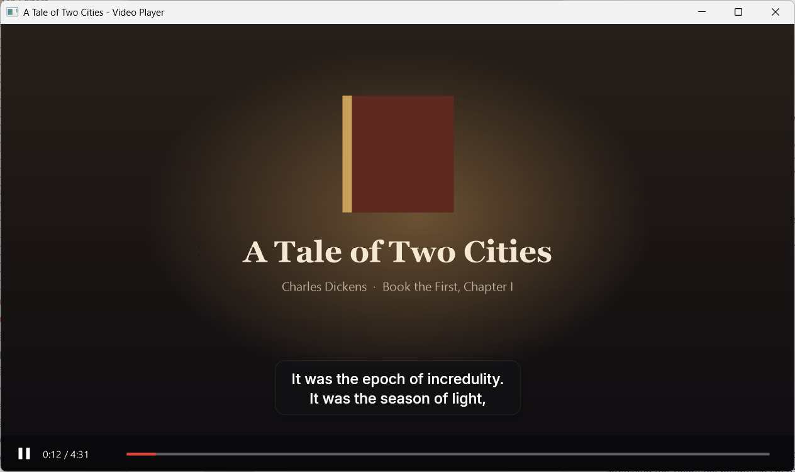
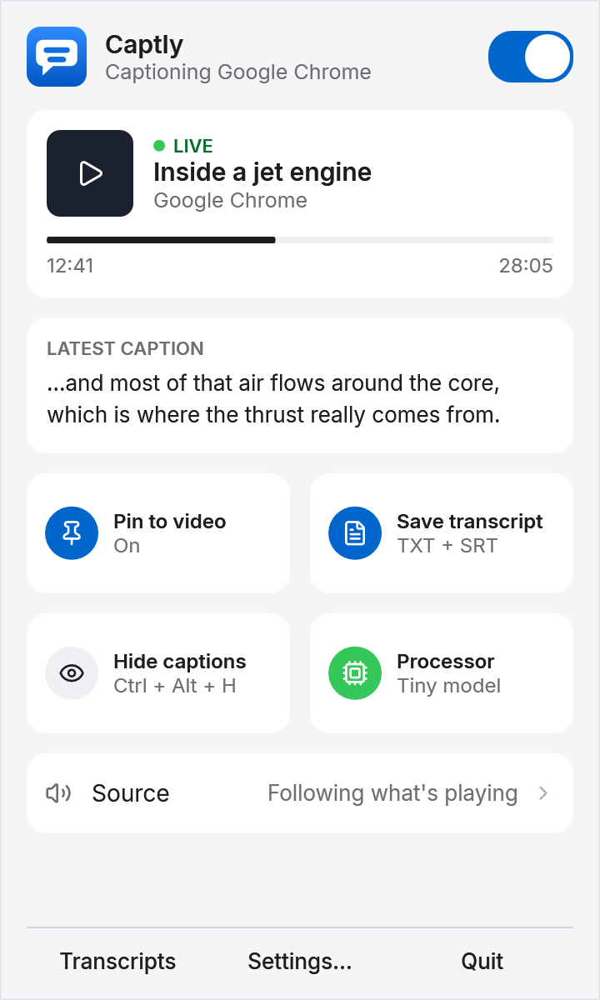
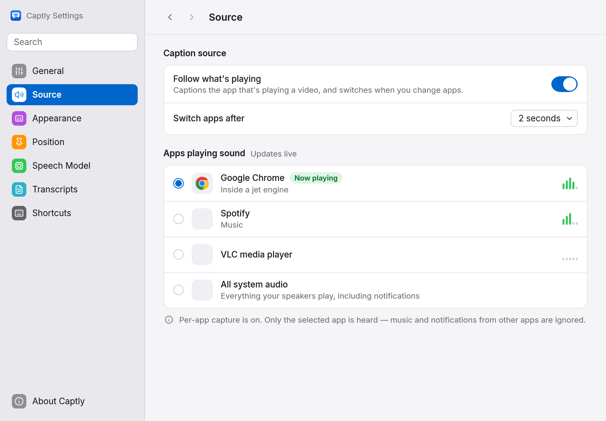
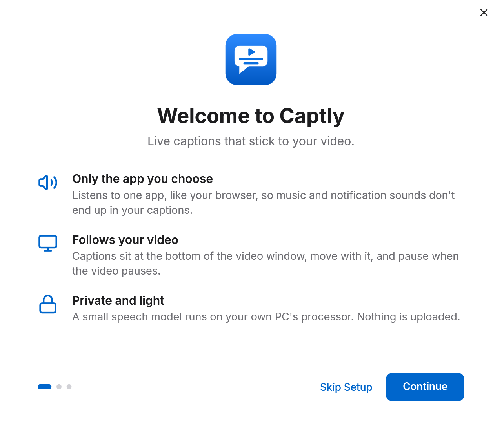
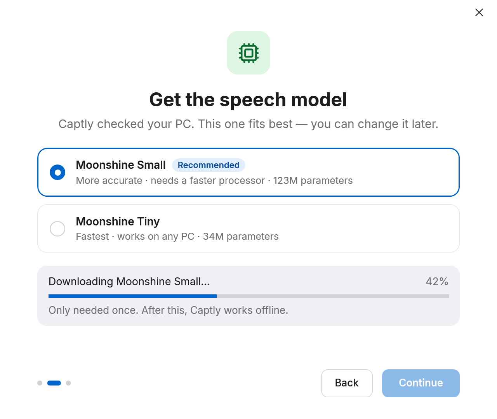
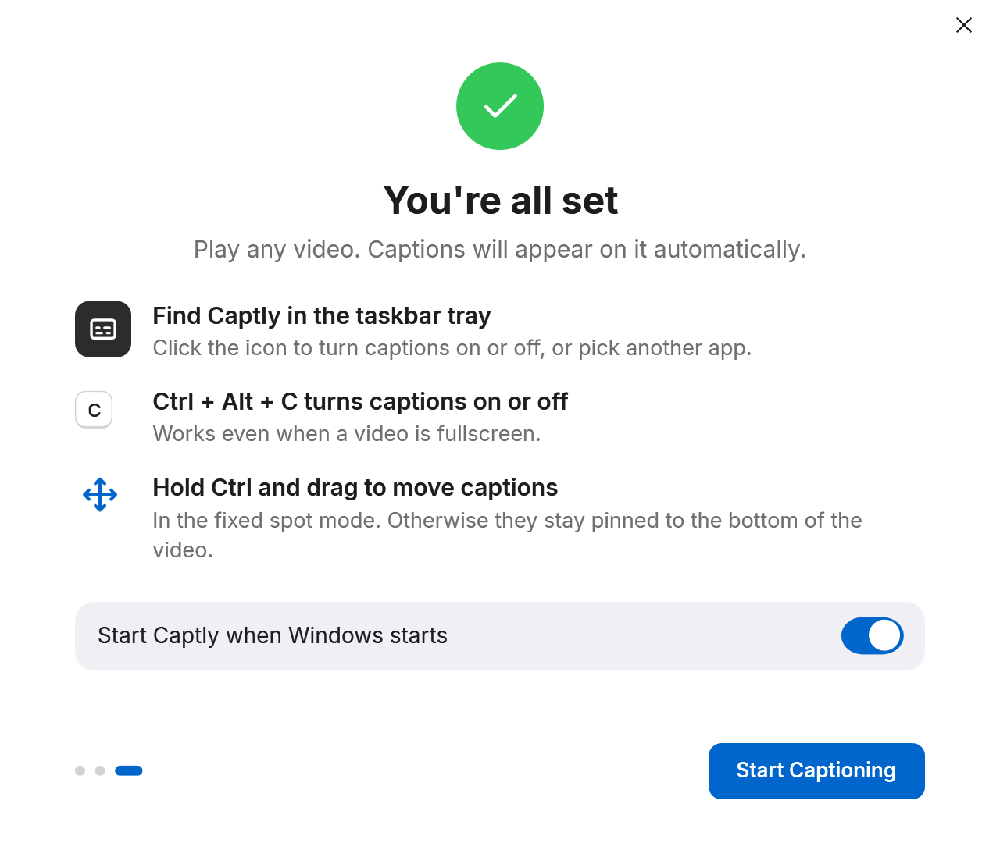
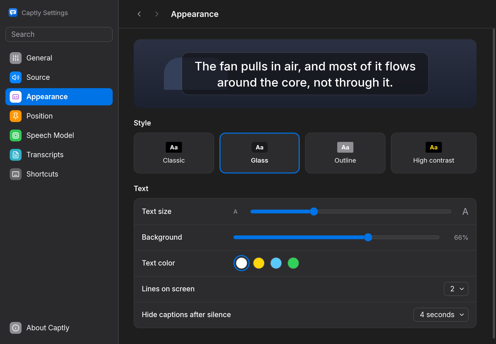

<p align="center">
  <picture>
    <source media="(prefers-color-scheme: dark)" srcset="assets/brand/logo-dark-mode.svg">
    
  </picture>
</p>

<p align="center"><b>Live captions that stick to your video.</b><br>
Captly listens to the app playing your video, turns speech into captions on your own PC, and shows them on the video itself.</p>

<p align="center">
  <a href="https://github.com/imahaider/Captly/releases/latest"><b>Download for Windows</b></a> ·
  <a href="docs/USER_GUIDE.md">User guide</a> ·
  <a href="docs/PRIVACY.md">Privacy</a> ·
  <a href="docs/BUILDING.md">Build from source</a>
</p>

<p align="center">
  
</p>

## What it does

- **Only the app you choose.** Captly hears one app, such as your browser, so music and notification sounds stay out of your captions. It follows whichever app is playing a video, or the one you pick.
- **On the video.** Captions sit at the bottom of the video's window, and move, resize and go fullscreen with it. They hide when the window is minimised or covered, and the video's controls under them still work.
- **Follows playback.** Pause the video and the captions pause. Skip ahead and old text clears at once.
- **Transcripts.** Each video gets a text file and a subtitle (`.srt`) file in `Documents\Captly`, named after the video.
- **Private.** Speech recognition runs on your PC with [Moonshine](https://github.com/moonshine-ai/moonshine). Nothing you watch or hear is uploaded.
- **Out of the way.** It lives in the tray. Shortcuts work everywhere, even over a fullscreen video: Ctrl + Alt + C turns captions on or off, and Ctrl + Alt + H hides them.

<p align="center">
  
  &nbsp;
  
</p>

## Get started

1. Download the zip for your PC from [the latest release](https://github.com/imahaider/Captly/releases/latest): `win-x64` for Intel and AMD, `win-arm64` for Snapdragon and other ARM64 PCs.
2. Unzip it anywhere and run `Captly.exe`.
3. Setup times your PC and downloads the speech model that suits it, once. Then play a video.

| Welcome | Get the speech model | You're all set |
|---|---|---|
|  |  |  |

Captly isn't code-signed yet, so Windows SmartScreen may say "Windows protected your PC". Choose **More info**, then **Run anyway**. To check the download, compare `Get-FileHash` of the zip with the `.sha256` file beside it.

Nothing is installed: settings live in `%APPDATA%\Captly` and models in `%LOCALAPPDATA%\Captly`. The [user guide](docs/USER_GUIDE.md) covers every screen and setting.

## Requirements

- Windows 11, on an Intel, AMD or ARM64 PC. Windows 10 should work too, captioning all system audio rather than one app, but hasn't been tested.
- About 200 MB of disk, plus 43 MB or more for a speech model.
- English speech. More languages are planned.

## Make it yours

<p align="center">
  
</p>

Four caption styles, any size, four text colours, a background you can fade, and a light, dark or matching theme. Captions can also sit at a fixed spot on screen: hold Ctrl and drag them there.

## Questions

**Does it work with YouTube, Netflix, VLC…?** It works with any app that plays sound. It reads the video's title and whether it's playing from Windows' media controls, which browsers and most players report.

**How much does it slow my PC?** While someone is speaking, the smallest model uses about a third of one processor core on the Snapdragon X Plus it was built on. When nothing plays, it uses next to nothing. Settings › Speech Model can time your PC and suggest a model.

**Does it use my graphics card?** Not yet. No Moonshine model runs on one today, so the setting is there but unavailable.

**Why is a word sometimes wrong?** Captions come from speech recognition, not the video's own subtitles. Clear speech works best; loud music under the speech makes mistakes more likely.

**Something isn't working.** See [troubleshooting](docs/USER_GUIDE.md#troubleshooting), or [open an issue](https://github.com/imahaider/Captly/issues/new/choose) with the newest log from `%LOCALAPPDATA%\Captly\logs`.

## Build from source

```powershell
.\scripts\get-native.ps1        # the speech library
dotnet build Captly.slnx -c Release
dotnet test --solution Captly.slnx -c Release
.\scripts\publish.ps1           # the portable zip, in dist\
```

You need the .NET 10 SDK. [Building Captly](docs/BUILDING.md) explains each step and how the code is laid out.

## Licence

MIT, © 2026 MAH. See [LICENSE](LICENSE). Captly is built on open-source libraries, listed with their licences in [THIRD_PARTY_NOTICES.md](THIRD_PARTY_NOTICES.md).
