# Using Captly

Captly puts live captions on whatever video you're watching: in a browser, a video player, or any app that plays sound. Everything happens on your own PC.

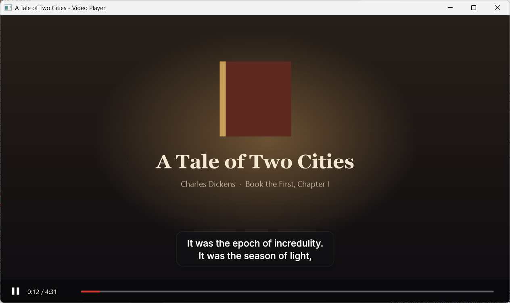

## First run

Unzip the download anywhere and run `Captly.exe`. Setup takes about half a minute.

| 1. Welcome | 2. Get the speech model | 3. You're all set |
|---|---|---|
| 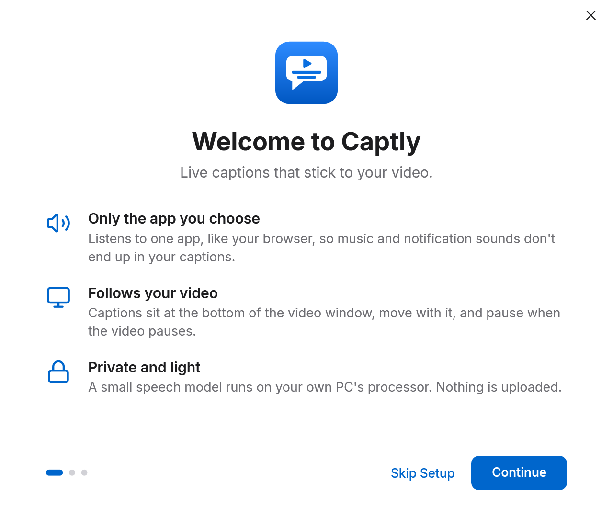 | 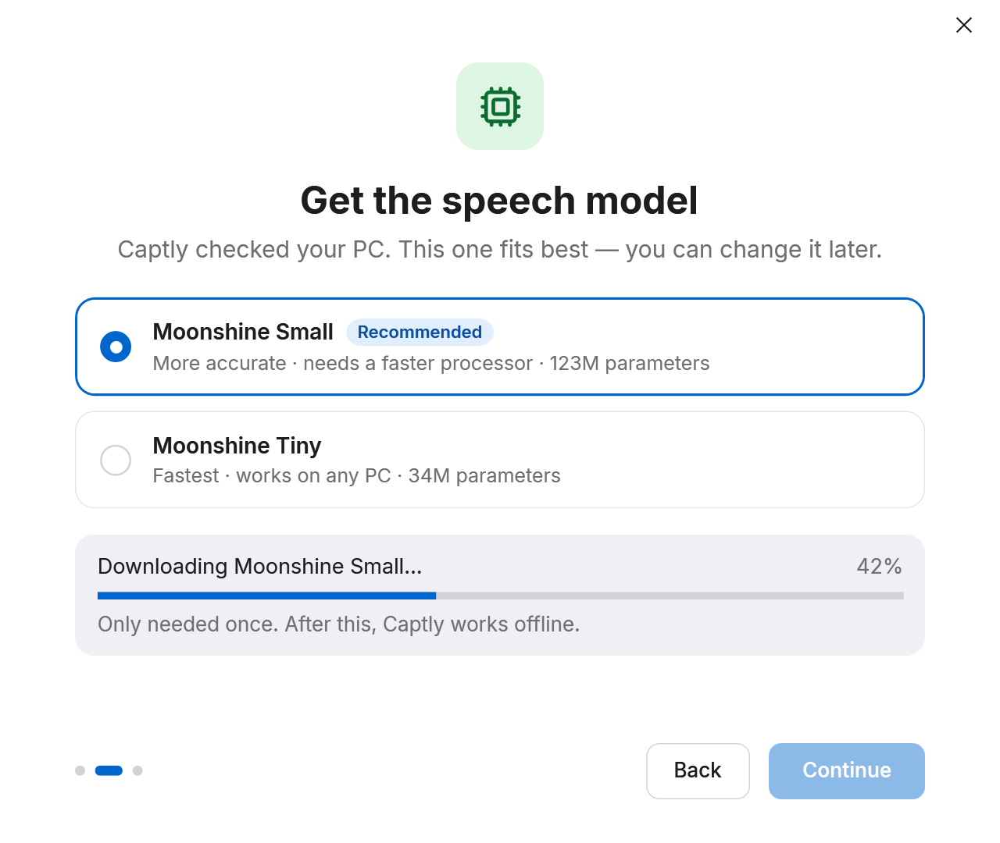 | 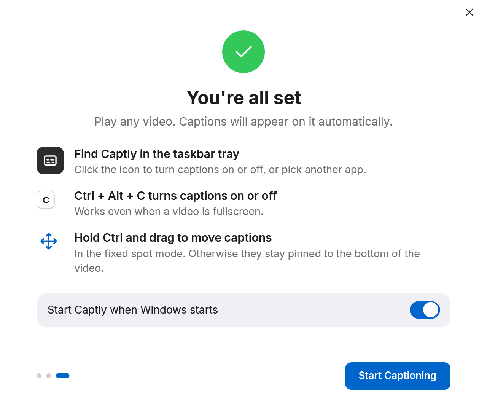 |

1. **Welcome** explains what Captly does. **Skip Setup** leaves without downloading anything.
2. **Get the speech model** downloads the smallest model (43 MB), times it on your PC, and recommends a model. A faster PC is offered a larger, more accurate one, which is downloaded too. **Continue** becomes available once the model is downloaded and checked.
3. **You're all set** asks whether Captly should start with Windows. **Start Captioning** turns captions on.

If the download fails, check your internet connection and press **Try Again**. The model is only downloaded once; after that, Captly works offline.

## Watching with captions

Play a video. Captions appear on it within about a second of someone speaking.

- **Captions follow the video window.** Move it, resize it or make it fullscreen, and the captions come along. Bigger windows get bigger text.
- **Pausing the video** clears the captions after a second. Playing again brings them back.
- **Skipping ahead or back** clears the old text at once.
- **Minimising the window**, or putting another window over the video, hides the captions.
- **Clicks go through the captions,** so the video's controls under them still work.

## The tray icon and popover

Captly lives in the taskbar tray, near the clock. If you don't see it, look behind the **^** arrow and drag it onto the taskbar.

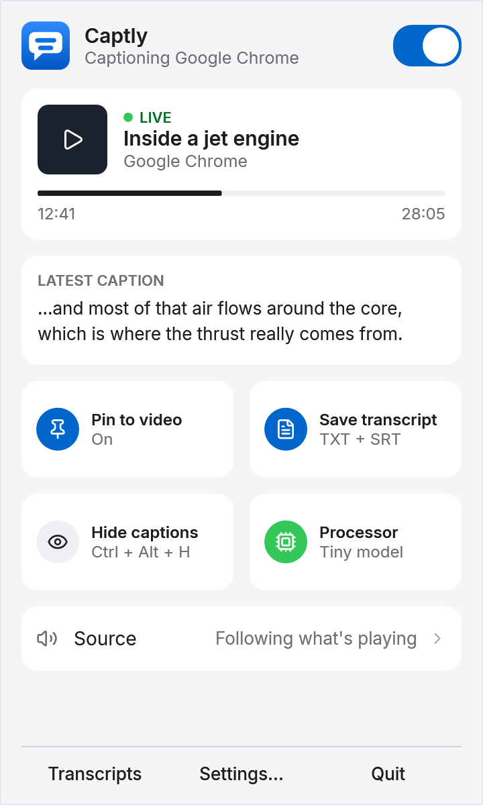

The icon shows whether captions are on and captioning, on and waiting for a video, or off. Click it to open the popover:

- The **switch** at the top turns captions on or off.
- **Now playing** shows the video Captly is captioning, from Windows' media controls.
- **Latest caption** repeats the last thing said, in case you missed it.
- **Pin to video** switches between captions on the video and captions at a fixed spot on screen.
- **Save transcript** turns transcripts on or off.
- **Hide captions** keeps captioning, and the transcript, without showing anything on screen.
- **Source** shows which app Captly is listening to, and opens the Source settings.

Right-click the icon for a short menu with the same actions and **Quit Captly**.

## Shortcuts

These work everywhere, even over a fullscreen video. Change them in Settings › Shortcuts.

| Shortcut | What it does |
|---|---|
| Ctrl + Alt + C | Turn captions on or off |
| Ctrl + Alt + H | Show or hide captions |
| Ctrl + Alt + S | Switch to the next app playing sound |
| Ctrl + Alt + T | Open the transcript of this video |
| Ctrl + Alt + O | Open Captly settings |

## Settings

Open Settings from the popover, with Ctrl + Alt + O, or by starting Captly again. Every change applies at once. The search box finds any setting by name.

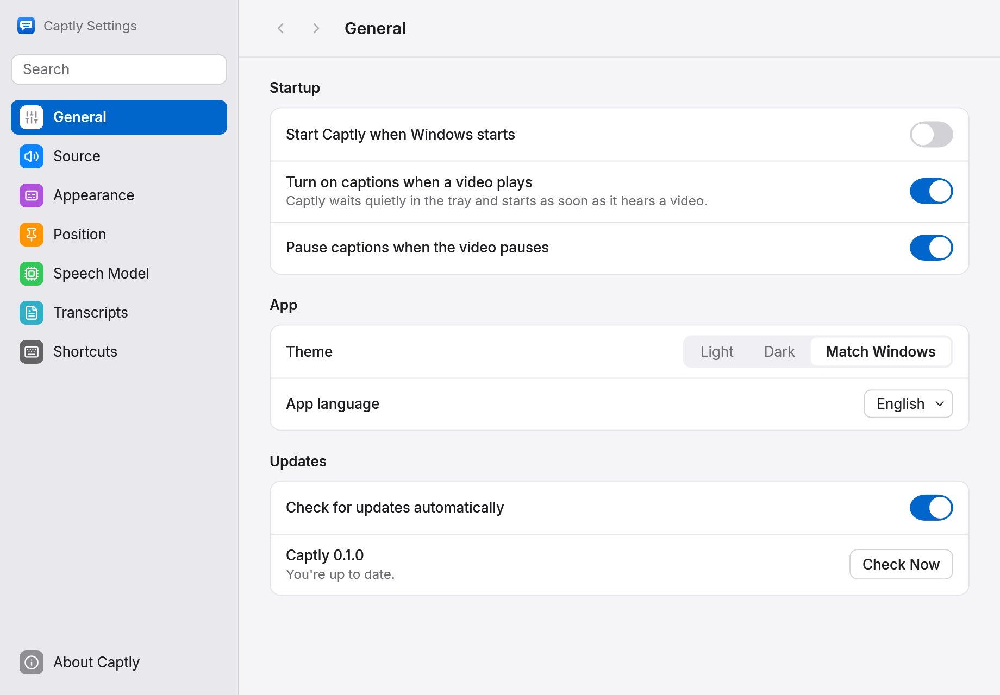

**General:** start with Windows, turn captions on when a video plays, pause with the video, light or dark theme, and update checks.

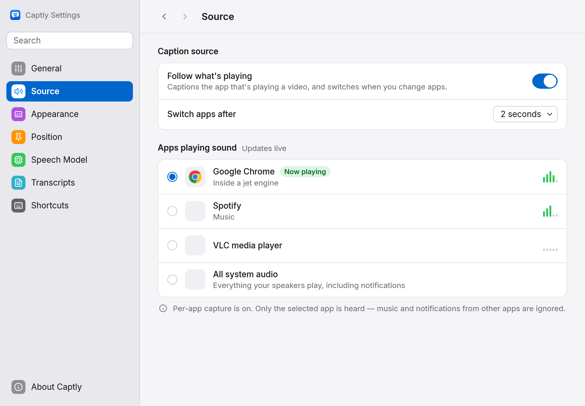

**Source:** which app Captly listens to. **Follow what's playing** picks the app playing a video by itself, and prefers a video over music. Or pick one app from the list, or **All system audio**. Only the chosen app is heard, so music and notification sounds from other apps stay out of your captions.

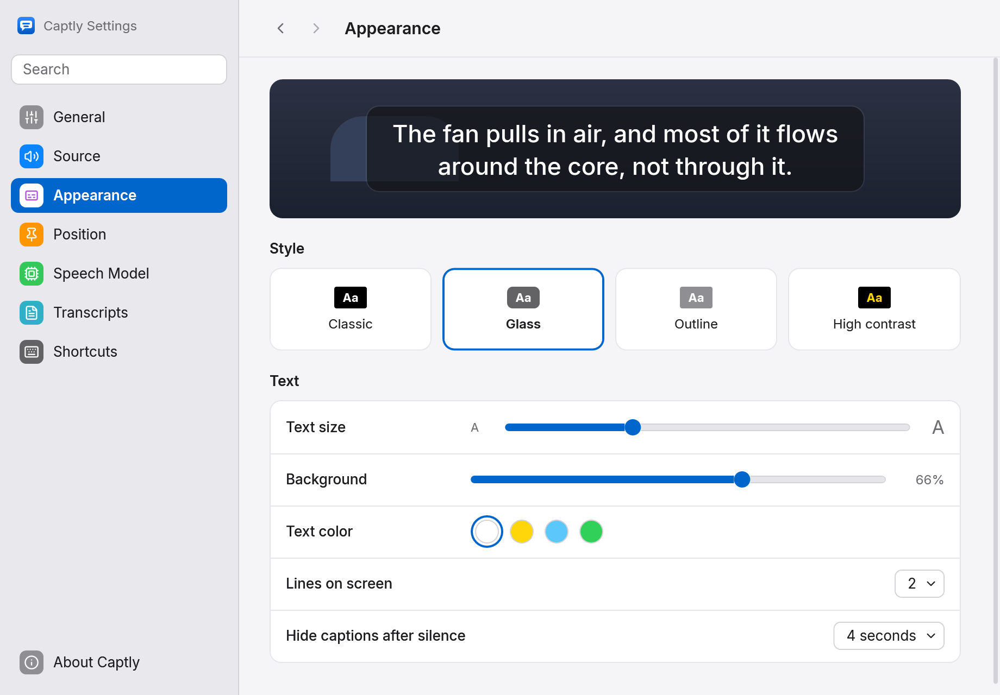

**Appearance:** four caption styles (Classic, Glass, Outline and High contrast), text size, background, text colour, how many lines show, and how soon captions clear after silence. The preview shows each change.

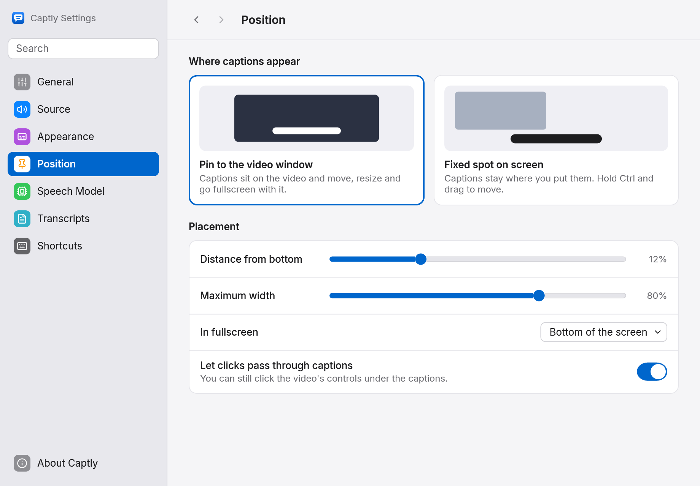

**Position:** captions on the video window, or at a fixed spot on screen. In the fixed mode, hold **Ctrl** over the captions and drag them where you like. You can also set how high they sit, how wide they may get, where they go in fullscreen, and whether clicks pass through them.

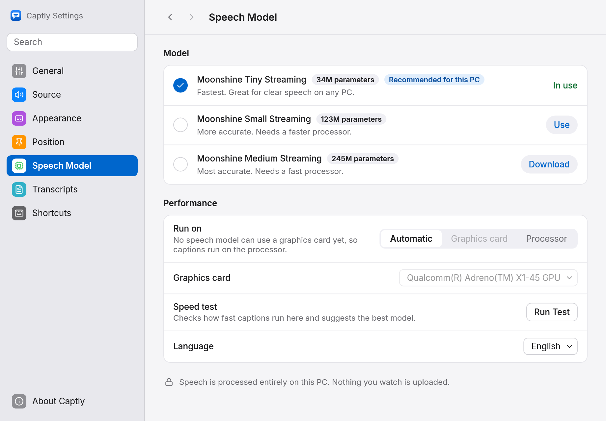

**Speech Model:** download and switch between the Tiny, Small and Medium models. Larger models are more accurate and need a faster processor. **Run Test** times your PC and suggests the best fit. Captly runs on the processor; graphics cards aren't used yet.

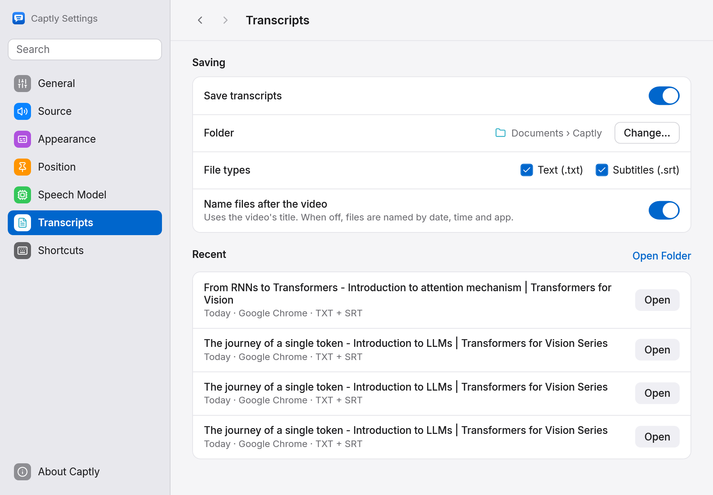

**Transcripts:** each video gets a text file and a subtitle (`.srt`) file, named after the video, in `Documents\Captly` unless you choose another folder. The newest ones are listed here.

## Troubleshooting

**No captions appear.** Check that the tray icon isn't crossed out (captions off). In Settings › Source, check that the app playing your video is listed and chosen, or try **All system audio**. Captions only appear when someone speaks.

**Captions show on the wrong window.** If an app has several windows, Captly picks the one whose title names the video. Bring the video's window to the front, or use the fixed spot mode.

**Windows says "Windows protected your PC".** Captly isn't code-signed yet. Choose **More info**, then **Run anyway**.

**My PC is slow while captioning.** Use the Tiny model (Settings › Speech Model). On the Snapdragon X Plus Captly was built on, Tiny uses about a third of one processor core while someone speaks, and next to nothing when nothing plays.

**Something else went wrong.** [Open an issue](https://github.com/imahaider/Captly/issues/new/choose) and attach the newest file from `%LOCALAPPDATA%\Captly\logs`.

## Removing Captly

Quit Captly from the tray, then delete its folder, `%APPDATA%\Captly` (settings) and `%LOCALAPPDATA%\Captly` (models and logs). Your transcripts in `Documents\Captly` are yours to keep or delete. If you turned on "Start Captly when Windows starts", turn it off first, or remove Captly from Settings › Apps › Startup.
